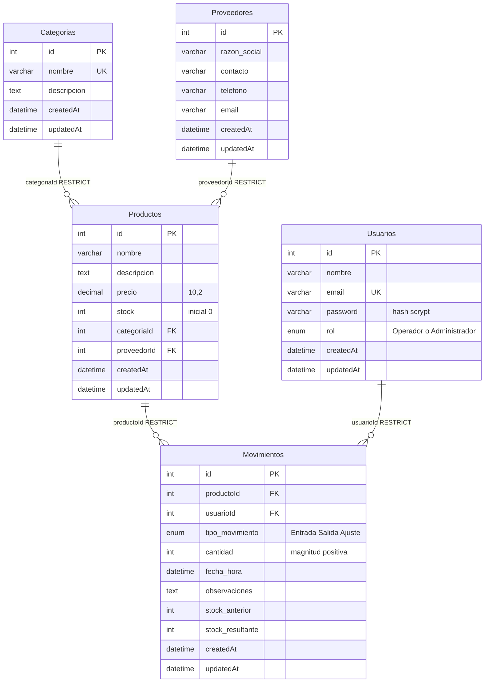

# DER — Laboratorio 9

Este diagrama corresponde a `models/index.js`. Las cinco tablas usan InnoDB,
ID entero autoincremental y `createdAt`/`updatedAt`. No hay tablas intermedias.
MariaDB de XAMPP en Windows normaliza los nombres de tablas a minúsculas:
phpMyAdmin muestra `categorias`, `proveedores`, `usuarios`, `productos` y
`movimientos`. Son las mismas tablas representadas por sus nombres Sequelize.

Todas las FK son obligatorias (`NOT NULL`), con `ON DELETE RESTRICT` y
`ON UPDATE CASCADE`. Las categorías y proveedores pueden existir sin productos;
los productos y usuarios pueden existir sin movimientos.

Las restricciones FK se crean en MariaDB, no solo en JavaScript. El stock
no negativo se valida en el modelo y, para movimientos, dentro de la transacción
con bloqueo de la fila de producto. Los saldos permiten identificar si un ajuste
sumó o restó unidades; `cantidad` conserva siempre la magnitud positiva.

Vista exportable para captura: [DER.svg](./DER.svg).
